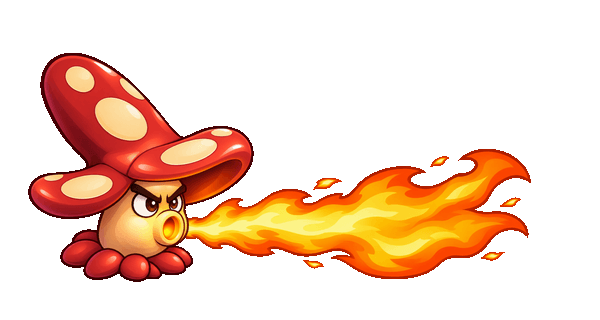

# Fireshroom artwork

Artwork prepared from the supplied `fireshroom.gif`, matching Backyard Brigade's existing painted cartoon style. Fireshroom is playable using shortcut `6`: 200 sun, 100 health, 75 area damage per target over 3 seconds, followed by 5 seconds of recharge.

## Character states

| State | Full-resolution transparent PNG | Optimized game asset |
| --- | --- | --- |
| Ready / idle | [idle.png](../../public/assets/fireshroom/idle.png) | [idle.webp](../../public/assets/fireshroom/idle.webp) |
| Firing, glowing mouth | [firing.png](../../public/assets/fireshroom/firing.png) | [firing.webp](../../public/assets/fireshroom/firing.webp) |
| Tired recharge, question mark | [recharging.png](../../public/assets/fireshroom/recharging.png) | [recharging.webp](../../public/assets/fireshroom/recharging.webp) |

All three character masters are 1254 × 1254 pixels with alpha transparency, the same framing and base position, and a right-facing mouth. Optimized character variants are 512 × 512. The question mark is included in the recharge sprite and fits within the same canvas.

The [192 × 192 transparent icon](../../public/assets/fireshroom/icon.webp) reuses the ready pose for a future plant card.

## Fire effect

The fire breath is separate from the plant, so it can cover two lawn tiles without enlarging the character or blocking tile placement.

- [Frame 1 PNG](../../public/assets/fireshroom/fire-1.png) / [WebP](../../public/assets/fireshroom/fire-1.webp)
- [Frame 2 PNG](../../public/assets/fireshroom/fire-2.png) / [WebP](../../public/assets/fireshroom/fire-2.webp)
- [Frame 3 PNG](../../public/assets/fireshroom/fire-3.png) / [WebP](../../public/assets/fireshroom/fire-3.webp)

Each flame master is 1774 × 887 pixels (2:1); optimized variants are 1024 × 512. All face right and keep the left emission root aligned. Suggested flame frame duration is 100 ms, repeating the three frames during the 3-second active phase. Match the flame's emission root to the firing sprite's mouth when implementing the attack; damage range should be calculated in board coordinates independently of the decorative flame tips.

## Animation review

The preview contains a 3-second animated fire phase followed by a 5-second tired recharge phase, then repeats. It is a visual timing preview, not a running gameplay simulation. During recharge the fire is absent and the question mark is visible.

## Requested gameplay specification for implementation

| Property | Requested value |
| --- | --- |
| Name | Fireshroom |
| Health | 100 |
| Sun cost | 200 |
| Attack area | Two tiles directly ahead, in the same lane |
| Damage | 75 per target over 3 seconds, matching Watermelon Plant's complete two-slice volley |
| Fire duration | 3000 ms |
| Recharge after fire | 5000 ms; cannot attack |
| Recharge appearance | Tired face with a question mark above the cap |

Generation used the built-in image tool. [Exact generation/edit prompts](PROMPTS.md) are retained for revisions. The PNG files preserve the generated artwork; WebP variants and the GIF are mechanical exports/assembly of that artwork. The game uses the optimized WebP state images and flame frames.
